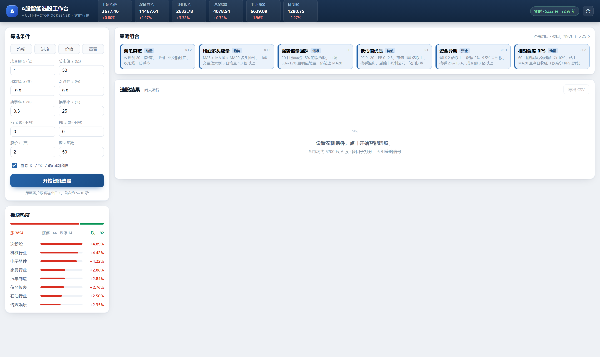
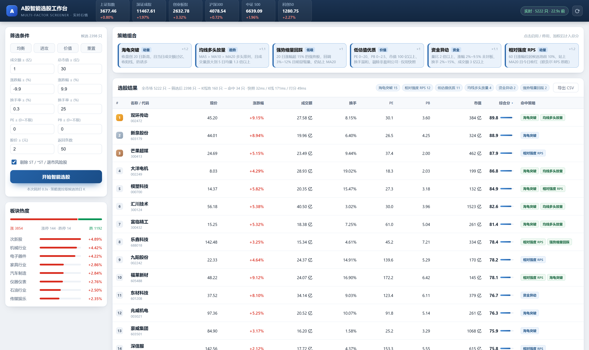
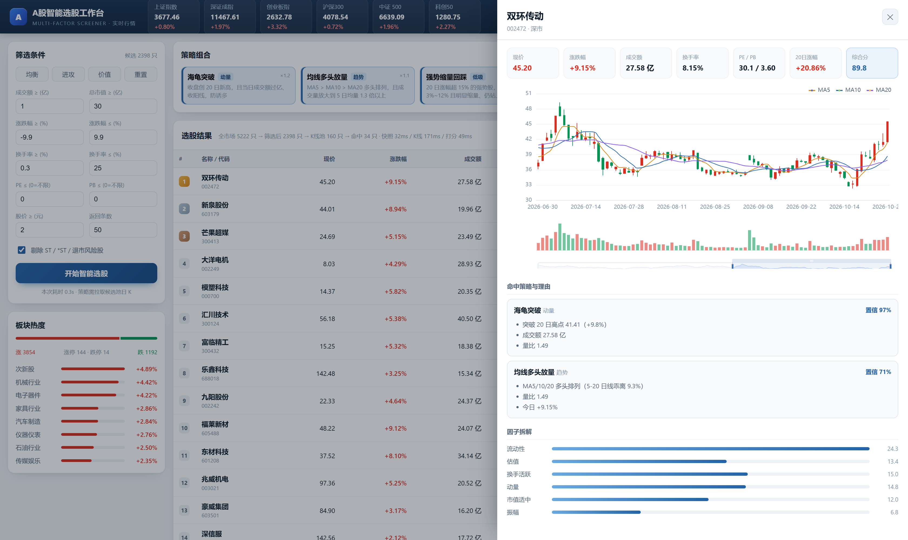
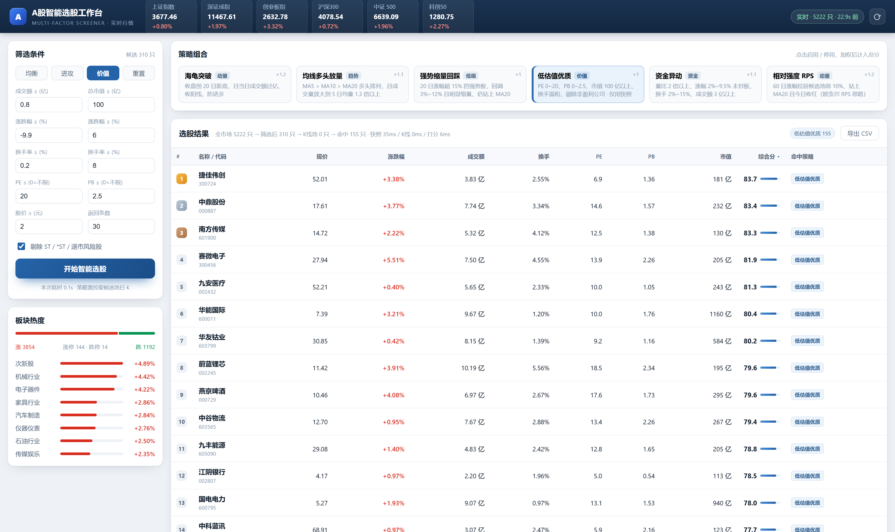

# A股智能选股工作台

> 零依赖的本地 Web 选股工具：全市场实时快照 + 多因子打分 + 6 组技术策略信号 + 个股 K 线。
> **不需要 pip install 任何东西**，Python 3.10+ 标准库直接跑。

[](https://github.com/1206673983-cmd/Stock-choser)

## 截图

| 首屏概览 | 选股结果 |
|---|---|
|  |  |

| 个股详情（K线） | 价值型筛选 |
|---|---|
|  |  |

---

## 一、先看效果

```bash
cd astock-screener
python app.py
# 浏览器打开 http://127.0.0.1:8770
```

启动后自动预热全市场快照（约 2 秒，5200+ 只），左侧调条件、点「开始智能选股」，
约 0.5 秒出结果（K 线已有磁盘缓存时），冷启动 5~10 秒。

---

## 二、开发前的 GitHub 调研结论

动手前用 GitHub API 扫了 A 股选股类项目，命中 44 个，按相关度筛出这 4 个真正的参考对象：

| 项目 | Star | 技术栈 | 借鉴了什么 | 没沿用为什么 |
|---|---|---|---|---|
| **sngyai/Sequoia-X** | 8.3k | Python + baostock + SQLite | **架构骨架**：`strategy/base.py` 策略抽象基类、策略与通知解耦、Pydantic 风格配置分层 | 它是 CLI + 飞书推送，无 Web；baostock 只有日线，无法做盘中实时 |
| **Dzy-HW-XD/a-share-quant-selector** | 468 | Python + akshare + Flask | **Web 产品形态**：策略结果分类、K 线可视化、筛选手感 | akshare 依赖重、单策略（碗口反弹）不够通用 |
| **ling-0729/KHunter** | 641 | Python | 全流程分层（数据/策略/择时/风控/回测）的目录划分 | 体量过重，本地跑需要数据库与调度器 |
| **ArvinLovegood/go-stock** | 8.0k | Go + 桌面端 | AI 分析的产品化组织方式 | Go + 桌面端，二次开发成本高 |

**最终选择：借 Sequoia-X 的策略抽象骨架 + a-share-quant-selector 的 Web 形态，自己重写数据层。**

关键差异点在**数据层**——调研发现所有项目都卡在数据源稳定性上，所以本项目把它做成了多源容错（见第五节）。

---

## 三、功能

| 模块 | 说明 |
|---|---|
| **大盘概览** | 6 大指数实时、涨跌家数、涨停/跌停数、两市总成交额、板块涨幅榜 |
| **多因子筛选** | 成交额、市值、涨跌幅区间、换手率区间、PE、PB、股价、剔除 ST |
| **智能打分** | 6 因子加权（流动性 25% / 估值 25% / 换手 15% / 动量 15% / 市值 12% / 振幅 8%），输出 0~100 |
| **策略信号** | 6 组策略独立判定，命中后最多加 25 分，并给出可读理由 |
| **个股 K 线** | 点击任意一行弹出抽屉：180 根日 K + MA5/10/20 + 成交量 + 缩放 |
| **导出** | 一键导出 CSV（带 BOM，Excel 直接打开不乱码） |

### 6 组策略

| 策略 | 类型 | 核心条件 |
|---|---|---|
| 海龟突破 | 动量 | 收盘创 20 日新高 + 成交额过亿 + 收阳线（防诱多） |
| 均线多头放量 | 趋势 | MA5 > MA10 > MA20 + 量比 ≥ 1.3 + 今日收红 |
| 强势缩量回踩 | 低吸 | 20 日涨幅 > 15% + 回调 3%~12% + 缩量至 0.9 倍以下 + 站上 MA20 |
| 低估值优质 | 价值 | PE 0~20 + PB 0~2.5 + 市值 > 100 亿 + 换手温和（纯快照，不需 K 线） |
| 资金异动 | 资金 | 量比 ≥ 2 + 涨幅 2%~9.5% 未封板 + 换手 2%~15% + 成交额 > 3 亿 |
| 相对强度 RPS | 动量 | 60 日涨幅居候选池前 10% + 站上 MA20 + 今日收红（欧奈尔思路） |

策略只需继承 `BaseStrategy` 并实现 `evaluate()`，注册后自动出现在前端。

---

## 四、目录结构

```
astock-screener/
├── app.py                   # 入口：零依赖 HTTP 服务 + API 路由
├── screener/
│   ├── config.py            # 配置：TTL、字段映射、默认筛选条件
│   ├── datasource.py        # 数据层：新浪/腾讯/东财三源 + 重试 + 二级缓存
│   ├── factors.py           # 因子计算、筛选、K 线派生指标
│   ├── strategies.py        # BaseStrategy + 6 个策略实现
│   ├── scoring.py           # 复合打分模型
│   └── service.py           # 编排：快照→筛选→K线池→策略→打分→排序
├── static/
│   ├── index.html
│   ├── style.css
│   ├── app.js
│   └── vendor/echarts.min.js   # 本地内置，不依赖 CDN
└── data/cache/              # K 线磁盘缓存（6 小时 TTL）
```

分层原则跟 Sequoia-X 一致：**数据层不知道策略存在，策略层不知道数据从哪来**。

---

## 五、数据层：为什么这么设计

实测（2026-10）三家免费接口的真实脾气：

| 数据源 | 用途 | 实测问题 | 对策 |
|---|---|---|---|
| **新浪** Market_Center | 全市场快照（主） | 单页硬顶 100 条，8 并发下偶发返回 `null` | 用 count 接口定页数，`null` 判定为失败重试，失败页串行补两轮 |
| **腾讯** ifzq | 日 K 线（主） | 无成交额/换手字段 | 仅用于算均线与量比，成交额仍取快照 |
| **东财** push2 | 板块、指数、备胎 | 每页顶 100 条，**深分页和突发并发会被掐断连接** | 降级为备源，只在主源失败时启用 |

四层容错：

1. **请求级**：指数退避重试（0.8s → 1.6s → 3.2s，带抖动）
2. **分页级**：并发 8 页 + 失败页串行补两轮
3. **源级**：新浪失败切东财，K 线腾讯失败切东财
4. **缓存级**：`stale-while-error` —— 全挂了也返回最近一次成功的数据并打上 `stale` 标记，前端徽标变黄，而不是白屏报错

性能实测：全市场 5222 只快照 **2 秒**；K 线 25 只/秒（冷）/ 缓存后近 0；一次完整选股 0.5~5 秒。

---

## 六、API

| 方法 | 路径 | 说明 |
|---|---|---|
| GET | `/api/health` | 探活 + 快照年龄 |
| GET | `/api/overview` | 指数、涨跌家数、成交额、板块榜 |
| GET | `/api/strategies` | 策略元数据 + 默认筛选条件 |
| POST | `/api/screen` | 执行选股（body 见下） |
| GET | `/api/kline?code=600519&market=1&bars=180` | 个股 K 线 + 指标 |

```jsonc
// POST /api/screen
{
  "filters": { "min_amount_yi": 1, "pct_min": -9.9, "pe_max": 0, "exclude_st": true },
  "strategies": ["turtle_breakout", "rps_strength"],   // 省略 = 全开
  "top_n": 50
}
```

返回里每行都带 `score`（总分）/ `base_score`（基准分）/ `signal_score`（信号分）/
`components`（因子拆解）/ `signals`（命中策略与理由），前端据此渲染，不做二次计算。

---

## 七、打分模型

```
总分 = 基准分 × 75% + 策略信号分 × 25%

基准分（横向分位归一）
  流动性（成交额分位）   25%
  估值（PE/PB 越低越好）  25%
  换手活跃（3%~10% 最优） 15%
  动量（今日涨幅分位）    15%
  市值适中（50~800 亿）   12%
  振幅（2%~8% 最优）       8%
```

刻意让基准分占大头：**没有命中任何策略的票也能凭基本面拿到合理分数**，
避免「没进 K 线候选池就必然垫底」的偏差。命中策略则在此之上最多加 25 分。

---

## 八、局限与免责

- **不构成投资建议。** 所有信号是基于历史价量的统计特征，不预测未来。
- **K 线候选池上限 160 只**（`config.MAX_KLINE_FETCH`）。策略只在这 160 只里跑，
  按成交额降序取。想要更大覆盖就把这个值调大（代价是首次要等更久）。
- 快照缺**行业字段**（新浪不提供、东财接口不稳），所以没做按行业筛选，只保留板块热度榜。
- 分钟级数据、龙虎榜、资金流向明细均未接入。
- 数据来自公开免费接口，**仅供个人研究**，请控制请求频率。

---

## 九、Roadmap

- [ ] 行业映射表（本地持久化东财 f100，一次构建长期复用）
- [ ] 回测：策略在历史区间的胜率与最大回撤
- [ ] 自选股监控 + 定时选股（收盘后自动跑，推送到飞书/企微）
- [ ] 北交所支持（当前口径与东财 `fs` 保持一致，剔除 bj）
